<picture>
  <source media="(prefers-color-scheme: dark)" srcset="assets/hero-dark.svg">
  
</picture>

<picture>
  <source media="(prefers-color-scheme: dark)" srcset="assets/ticker-dark.svg">
  
</picture>

## Hi, I'm Vinuki

I build the screens people use all day at work: point-of-sale terminals, live sales dashboards and mobile apps. I care about the details that make them feel fast and friendly.

-  **2 years commercial** at Sarasa Soft Solutions, shipping production Angular + TypeScript UI
-  BSc (Hons) Information Technology, specialising in Software Engineering, SLIIT
-  AI-assisted workflow (Claude, Copilot): used to move faster, never to skip understanding
-  Currently levelling up in **Next.js** and **Flutter**

## Tech stack

  <b>DAILY DRIVERS</b> 
  
  
  
  
  
  

  <b>ALSO SHIPPED WITH</b> 
  
  
  
  
  

  <b>LEVELLING UP</b> 
  
  
  

  <b>INFRA &amp; TOOLING</b> 
  
  
  

## Featured work

<table>
<tr>
<td width="50%" valign="top">
 
<b>Restaurant POS</b> 
A live, multi-branch POS built for fast-paced restaurant billing. I own features end to end: loyalty and promotion configs, workflows customised for each restaurant, and access-code security for sensitive operations. 
Angular · TypeScript · REST APIs (Swagger) 
<b>LIVE</b> · commercial · private code
</td>
<td width="50%" valign="top">
 
<b>Business Analysis Dashboards</b> 
Analytics on live POS and inventory data, with modules for sales, stock movement, product movement, customer insights and overall company performance. I built it end to end: MSSQL stored procedures, ASP.NET API endpoints and the Angular frontend. 
Angular 22 · TypeScript · Chart.js · ASP.NET · MSSQL 
<b>COMMERCIAL</b> · private code
</td>
</tr>
<tr>
<td width="50%" valign="top">
 
<b>Pharmacy POS</b> 
The restaurant POS, redesigned around how pharmacists work: keyboard-first, with hotkeys and arrow-key flows for adding products, creating customers, finalising bills, settling customer credit and running reports. 
Angular · TypeScript · REST APIs 
<b>COMMERCIAL</b> · private code
</td>
<td width="50%" valign="top">
 
<b>Sorbet Portfolio</b> 
My personal site, built like a cosy desktop: a grid of folders that open as windows, hand-drawn stickers and synthesized click sounds. 
Next.js · TypeScript · Tailwind CSS · Motion 
<b>IN PROGRESS</b> · launching soon
</td>
</tr>
</table>

## Contribution garden

<picture>
  <source media="(prefers-color-scheme: dark)" srcset="assets/garden-dark.svg">
  
</picture>

Each flower is one week of my last year on GitHub; busier weeks grow taller. Regrown nightly by a GitHub Action.

  <b>SAY HI</b> 
  
  
  <!-- todo: add once the portfolio is live
  
  -->

<picture>
  <source media="(prefers-color-scheme: dark)" srcset="assets/footer-dark.svg">
  
</picture>

